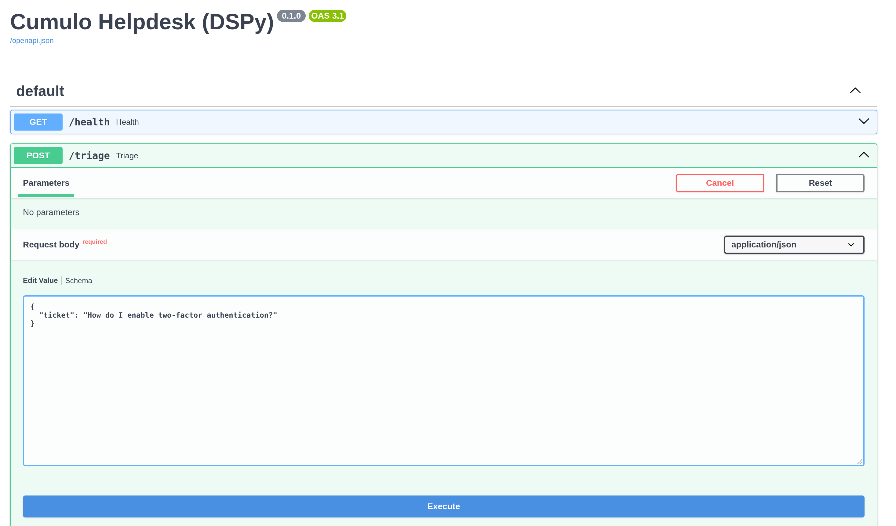
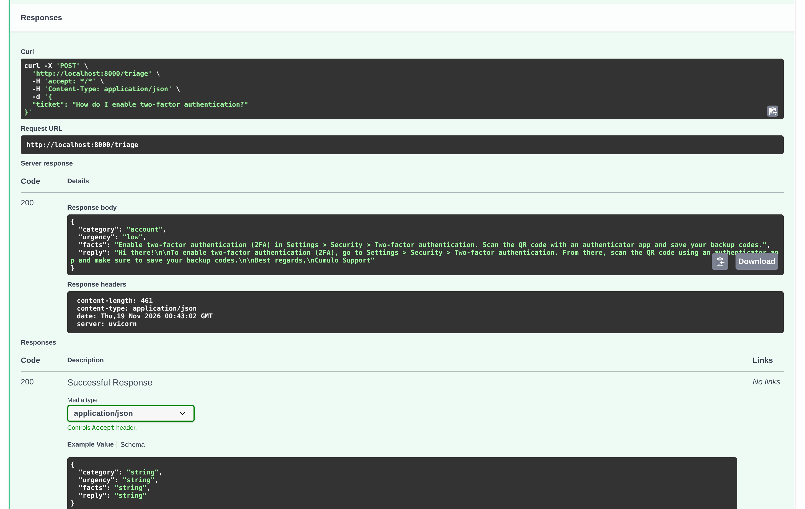

# DSPy Simple helpdesk
#### Gemini API

A pipeline that takes a raw customer ticket and returns:

 1. a category (billing, technical, account, feature_request, other),
 2. an urgency (low, medium, high),
 3. a drafted reply, grounded in a small knowledge base and checked against style rules.

```
        ticket ──► Triage (ChainOfThought) ──► category + urgency ─┐
           │                                                       ├─► Draft
         reply (ChainOfThought + Refine) ──► reply
           └────► Research (ReAct + search tool) ──► facts ────────┘

```

### Usage 
#### Terminal
```BASH
$ uv run python main "My invoice has the wrong company name, I need it fixed for taxes."

Category : billing
Urgency  : high
Facts    : To correct the company name on your invoice, reply to the invoice email. Support will reissue it within 2 business days.

Reply:
Hello!

To correct the company name on your invoice, please reply directly to the invoice email. Our support team will then reissue it within 2 business days.

Cumulo Support
```

#### Flashapi API

```BASH
# Terminal 1
$ uv run uvicorn api:app --reload
INFO:     Will watch for changes in these directories: ['/home/y44k0v/dev/python/DSPy/dspy-helpdesk']
INFO:     Uvicorn running on http://127.0.0.1:8000 (Press CTRL+C to quit)
INFO:     Started reloader process [2995259] using WatchFiles
INFO:     Started server process [2995261]
INFO:     Waiting for application startup.
INFO:     Application startup complete.
INFO:     127.0.0.1:41600 - "POST /triage HTTP/1.1" 200 OK

# Terminal 2
$ curl -X POST http://localhost:8000/triage \
  -H "Content-Type: application/json" \
  -d '{"ticket": "How do I enable two-factor authentication?"}'
{"category":"account","urgency":"low","facts":"Enable two-factor authentication (2FA) in Settings > Security > Two-factor authentication. Scan the QR code with an authenticator app and save your backup codes.","reply":"Hi there!\n\nTo enable two-factor authentication (2FA), go to Settings > Security > Two-factor authentication. From there, scan the QR code using an authenticator app and make sure to save your backup codes.\n\nBest regards,\nCumulo Support"}


```

Interactive docs are at http://localhost:8000/docs.





